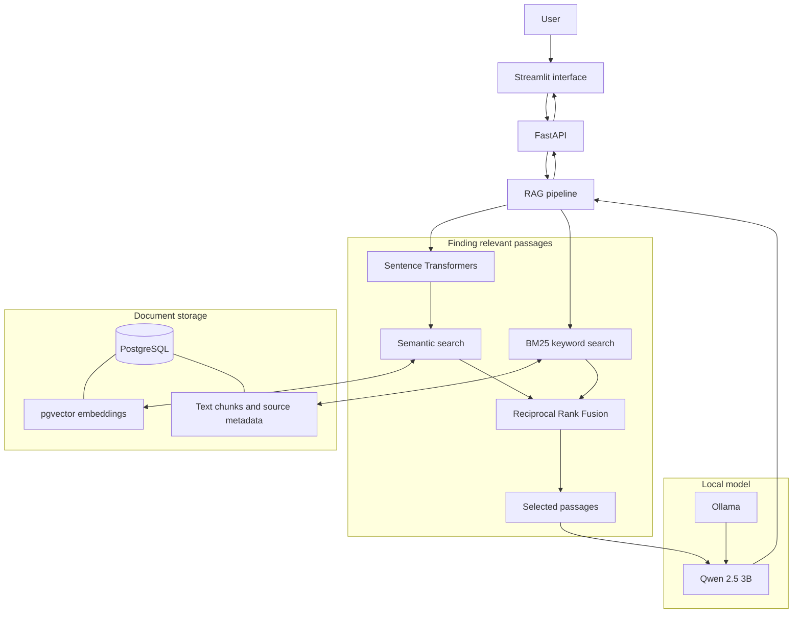
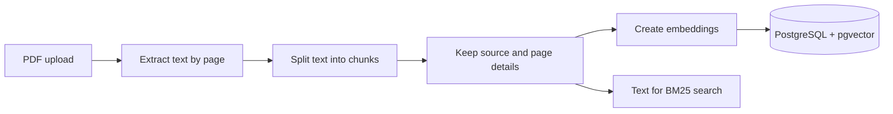
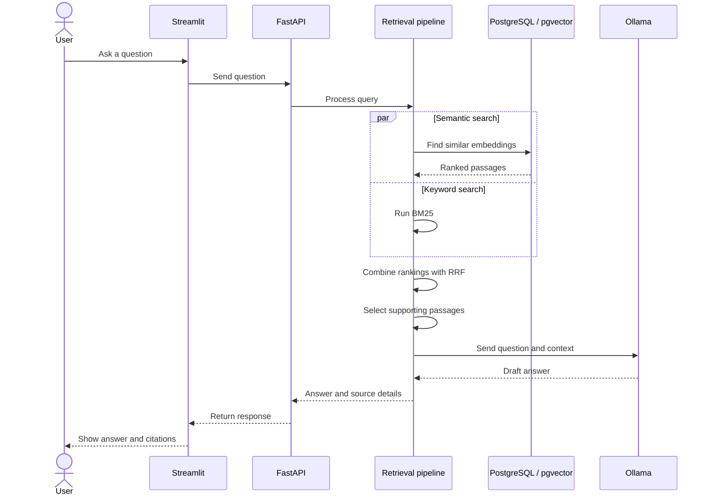

# RAG Knowledge Assistant

A small document Q&A app I built to explore how retrieval-augmented generation works in practice.

The idea is simple: upload a PDF, ask a question about it, and get an answer based on the document rather than relying only on what a language model already knows. I wanted to build the pieces myself—from storing document chunks and finding relevant passages to sending that context to a local model and returning the answer with its sources.

The project runs locally and uses **FastAPI, PostgreSQL with pgvector, BM25, Sentence Transformers, Ollama, and Streamlit**.

## What it does

- Accepts PDF documents and splits their text into smaller, overlapping chunks.
- Keeps source and page information with the chunks so retrieved text can be traced back to the document.
- Searches in two ways: semantic similarity for meaning and BM25 for keyword matches.
- Combines the two ranked result lists using Reciprocal Rank Fusion (RRF).
- Passes selected passages to a local language model to draft an answer.
- Returns the answer with source information, and can fall back when the document doesn't contain enough evidence.
- Provides a Streamlit interface as well as a FastAPI API.

This is a learning project and a working prototype, not a production-ready document platform. I’ve included tests and a small evaluation script so I can keep improving the retrieval behavior.

## How the pieces fit together

### System overview



In my current setup, Docker Compose runs the API and PostgreSQL. Ollama runs on the host machine, and the API container connects to it through `host.docker.internal` on macOS. I run the Streamlit frontend separately.

### What happens when a PDF is uploaded?



The source and page details matter: without them, it would be harder to check where an answer came from. The current pipeline is intended for PDFs that contain selectable text; scanned PDFs may need OCR first.

### What happens when someone asks a question?



The main reason for using both semantic search and BM25 is that they complement each other. Semantic search can find passages that express the same idea in different words, while BM25 can be useful for exact terms, names, acronyms, and technical phrases. RRF combines the rankings without needing the two search methods to produce directly comparable scores.

## Tech stack

| Part | Technology |
|---|---|
| API | Python, FastAPI, Pydantic |
| Frontend | Streamlit |
| Database | PostgreSQL |
| Vector search | pgvector |
| Embeddings | Sentence Transformers, `all-MiniLM-L6-v2` |
| Keyword search | BM25 |
| Ranking combination | Reciprocal Rank Fusion |
| Local text generation | Ollama, `qwen2.5:3b` |
| Running services | Docker Compose |
| Tests | pytest and GitHub Actions |

## Run it locally

These instructions assume macOS. Other operating systems may need small changes, especially for connecting Docker to Ollama.

### Requirements

- Docker Desktop with Docker Compose
- Python 3.11 or newer
- [Ollama](https://ollama.com/download)

### 1. Download the chat model

Install and start Ollama, then run:

```bash
ollama pull qwen2.5:3b
curl http://localhost:11434/api/tags
```

The `curl` command should return the models available to Ollama.

### 2. Set up environment variables

From the project directory:

```bash
cp .env.example .env
```

Check the values in `.env` and adjust them if your setup differs. The local configuration uses settings like these:

```dotenv
OLLAMA_BASE_URL=http://host.docker.internal:11434
CHAT_MODEL=qwen2.5:3b
EMBEDDING_MODEL=sentence-transformers/all-MiniLM-L6-v2
EMBEDDING_DEVICE=cpu
EMBEDDING_DIMENSIONS=384
```

Keep `.env` on your machine. It should not be committed to GitHub. The `.env.example` file is there to show the expected configuration without exposing personal credentials.

### 3. Start the API and database

```bash
docker compose up -d --build
docker compose ps
docker compose logs --tail=100 api
```

Useful local URLs:

- API health check: `http://localhost:8000/health`
- Interactive API docs: `http://localhost:8000/docs`
- Streamlit UI: `http://localhost:8501` after starting the frontend below

The first build can take a little while as dependencies and the embedding model are downloaded.

### 4. Start the Streamlit frontend

Open another terminal in the project directory:

```bash
python3 -m venv .venv
source .venv/bin/activate
python -m pip install --upgrade pip
pip install streamlit requests
streamlit run frontend/app.py
```

Open the local URL shown in the terminal, usually `http://localhost:8501`.

### 5. Upload a PDF and ask a question

You can use the Streamlit interface or open the API docs at `http://localhost:8000/docs`.

1. Upload a text-based PDF using the document upload endpoint (`POST /documents/upload`).
2. Send a question to `POST /ask`.
3. Check the answer and its source details against the original document.

An example question body is:

```json
{
  "question": "What are the main topics covered in this document?"
}
```

For the exact request and response fields, check the running API documentation and `app/schemas.py`.

## Project layout

```text
rag-knowledge-assistant/
├── app/
│   ├── main.py              # API endpoints
│   ├── rag.py               # Document ingestion and answer flow
│   ├── retrieval.py         # Search and ranking logic
│   ├── database.py          # Database connection and setup
│   ├── models.py            # Database models
│   ├── schemas.py           # Request and response schemas
│   └── config.py            # Configuration
├── frontend/
│   └── app.py               # Streamlit interface
├── evals/
│   └── questions.json       # Evaluation questions
├── scripts/
│   └── evaluate.py          # Evaluation script
├── tests/
│   └── test_retrieval.py    # Retrieval tests
├── .github/workflows/
│   └── tests.yml            # CI workflow
├── Dockerfile
├── docker-compose.yml
├── requirements.txt
├── .env.example
└── README.md
```

## Tests and evaluation

Run the tests from a Python environment with the project dependencies installed:

```bash
python3 -m venv .venv
source .venv/bin/activate
python -m pip install --upgrade pip
pip install -r requirements.txt
pytest -q
```

The `evals/questions.json` file and `scripts/evaluate.py` provide a starting point for checking retrieval against your own documents. Make sure the API is running and that the relevant PDFs have been uploaded before running the evaluation:

```bash
python scripts/evaluate.py
```

If the script generates `evals/latest_report.json`, review the report and then inspect some examples manually. Metrics can help spot regressions, but they don't prove that every answer is correct. Check whether the retrieved passages actually support the answer, especially for questions where the document contains no relevant information.

## Configuration notes

The following are common settings in this project. Check `app/config.py` for the exact names and defaults in your checkout.

| Setting | What it controls |
|---|---|
| `OLLAMA_BASE_URL` | Address used by the API to reach Ollama |
| `CHAT_MODEL` | Ollama model used to generate answers |
| `EMBEDDING_MODEL` | Sentence Transformers model used for embeddings |
| `EMBEDDING_DEVICE` | Device used for embedding inference |
| `EMBEDDING_DIMENSIONS` | Expected size of each embedding vector |
| `CHUNK_SIZE` / `CHUNK_OVERLAP` | Chunk length and overlap |
| `SEMANTIC_TOP_K` / `BM25_TOP_K` | Number of candidates considered by each retriever |
| `FINAL_TOP_K` | Number of passages passed to answer generation |
| `MAX_COSINE_DISTANCE` | Semantic distance threshold used by fallback logic |
| `ENABLE_LLM_RERANKER` | Whether the optional model-based reranking step is enabled |

If you change the embedding model, check its vector dimensions and rebuild the stored embeddings as needed. Vectors generated by different embedding models should not be mixed in the same index.

## A few things to keep in mind

- **Scanned PDFs:** the current pipeline extracts text; it does not include OCR for image-only pages.
- **Answer quality:** results depend on the source document, chunk size, retrieval settings, and language model. Always check citations for important answers.
- **Prompt injection:** document text is untrusted input. A PDF can contain instructions that should not be treated as system instructions.
- **Local model access:** Ollama is intended for local use by default. Avoid exposing it to an untrusted network.
- **Production use:** before deploying this for multiple users, add authentication, access controls, upload limits, rate limiting, logging, and monitoring.

## Ideas for future improvements

Some things I would like to build on next:

- OCR support for scanned PDFs.
- Better document management, including listing and deleting uploaded files.
- More thorough retrieval evaluation with Recall@k, MRR, and nDCG.
- Tests for whether answers are supported by their cited passages.
- User authentication and separation of each user's documents.
- Screenshots and a short demo showing the app in use.

---

I built this project to get a better understanding of how document retrieval and local language models work together. The most useful part has been seeing how much the quality of the answer depends on finding the right passages first—not just on the model itself.
